# Kaiserslautern Weather Scene

[](https://github.com/Boisti13/kaiserslautern-weather-scene/actions/workflows/check.yml)
[](LICENSE)
[](https://www.home-assistant.io)

An animated weather card for Home Assistant: the Kaiserslautern skyline,
drawn by hand, under a sky that follows the real weather, sun and moon.
Clouds drift with the wind, rain and snow fall, lightning flashes, the
windows light up at dusk, snow settles on the roofs, the trees change with
the seasons, a Christmas tree goes up in Advent, and on home match days of
1. FC Kaiserslautern the Betzenberg's floodlights come on. Now and then a
C-17 or a C-5 from Ramstein flies past.

Everything is plain SVG with CSS animation, picked and stacked by one Bubble
Card, so it runs in the browser: Home Assistant itself only keeps one
template sensor up to date.

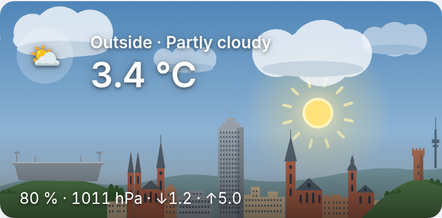

## Highlights

- **Hand-drawn skyline**: Betzenberg with the Fritz-Walter-Stadion, Stiftskirche, Pfalztheater, Rathaus, Marienkirche, St. Martin, Humberg with the Humbergturm, the Pfälzerwald and the Dansenberg TV tower
- **Daylight colours** that change with the light: red sandstone churches, slate spires, the grey Rathaus with its window grid; muted when overcast, violet at dusk, dark at night with **lit windows** and glowing church windows
- **11 weather types** from the forecast: clear, partly cloudy, cloudy, fog, rain, downpour, hail, sleet, snow, lightning, thunderstorm — each with its own sky and animation
- **Wind**: rain and snow slant with the wind's strength and direction, clouds drift the same way, faster when it's windy
- **Sun and moon move**: the sun follows its real path and sets as a low orange sun behind the hills; the moon shows its phase and rises about 50 minutes later every day; twinkling stars and a rare shooting star
- **Snow on the roofs** after snowfall, until it thaws
- **Seasons**: blossom in spring, green summer, autumn colours, bare trees in winter
- **Christmas**: a decorated tree and string lights from the Monday after Totensonntag to 6 January
- **Match days**: around a home game of 1. FC Kaiserslautern (fixtures from [OpenLigaDB](https://www.openligadb.de)) the stadium's floodlights, flags and a red-and-white shield appear
- **Aircraft**: a C-17 (every 2 minutes) and a C-5 (every 3 minutes) cross from left to right with blinking beacons and strobes
- **Kind to the server and the eyes**: no scripts in the pictures, files cached by the browser, every animation stops under *reduce motion*

| | | |
|---|---|---|
| 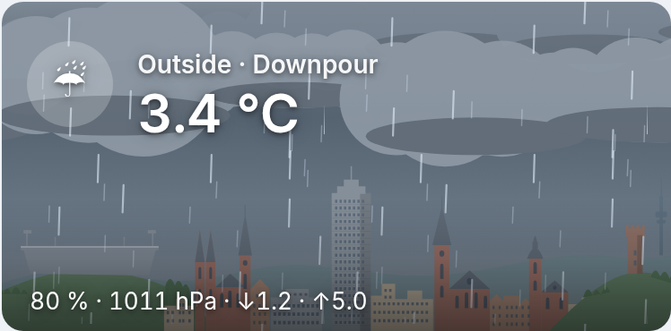 | 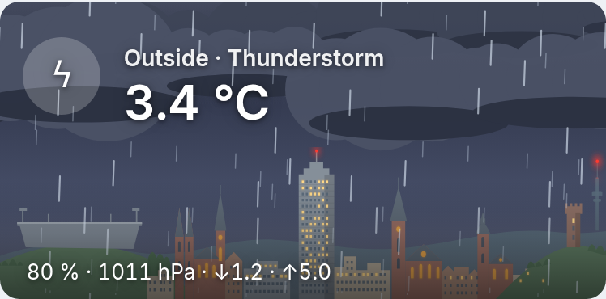 | 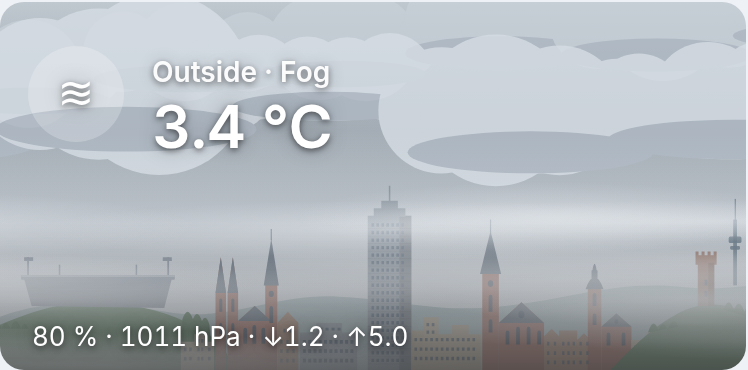 |
| 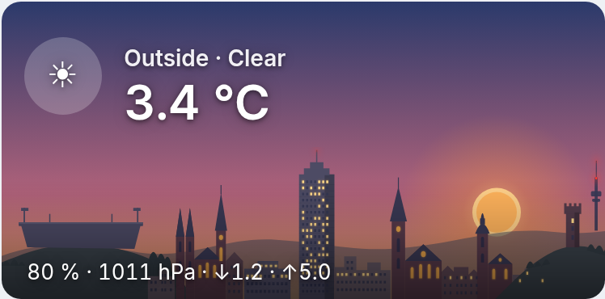 | 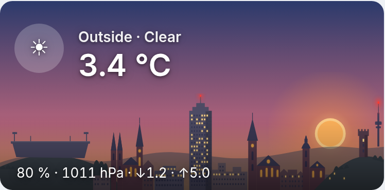 | 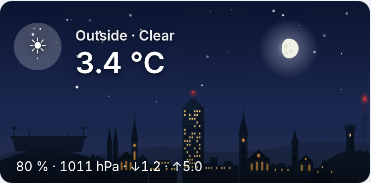 |
| 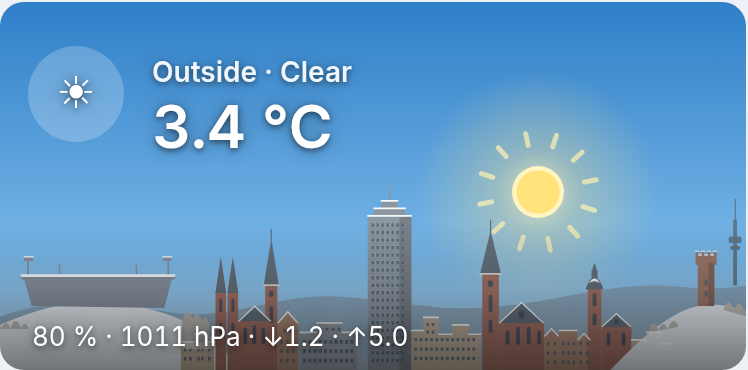 | 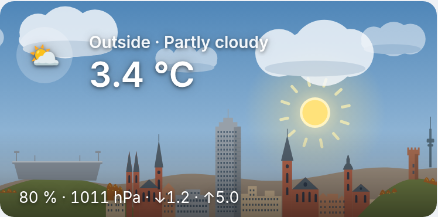 | 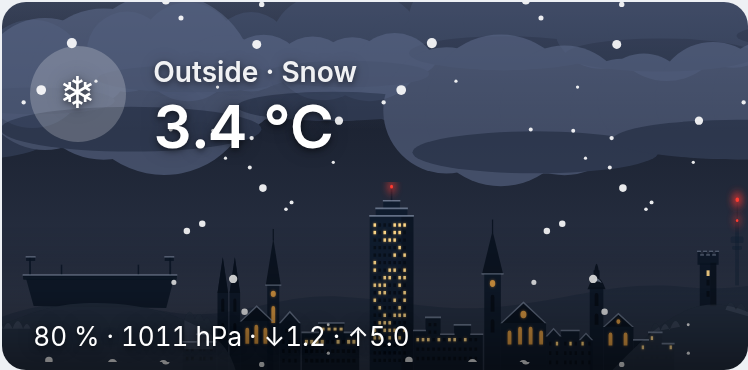 |
| 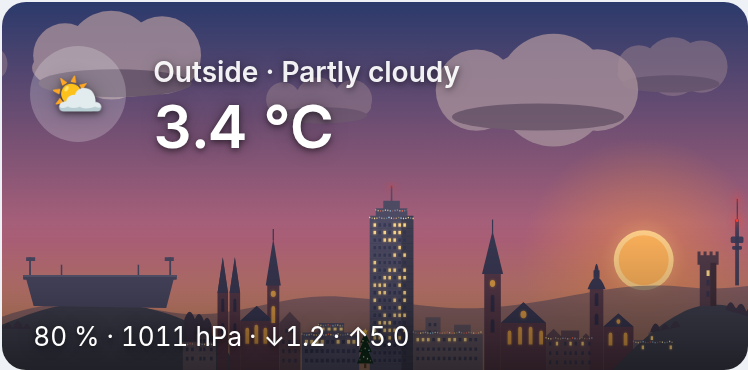 | 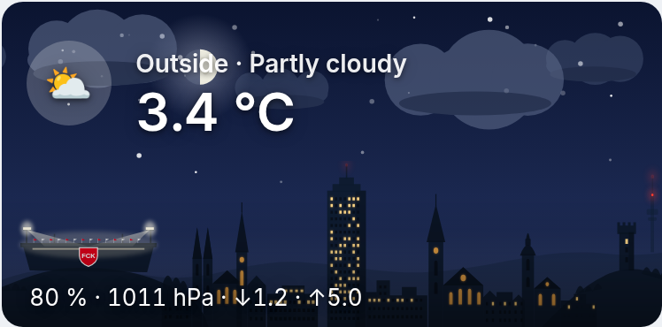 | |

All 48 scenes side by side: run `python3 art/gallery.py` and open `gallery.html`.

## What you need

| Part | What for |
|---|---|
| Home Assistant (tested with 2026.11) | template sensors with `this`, custom Jinja templates |
| [Bubble Card](https://github.com/Clooos/Bubble-Card) | the card that paints the scene (its `styles` run the layer code) |
| [vertical-stack-in-card](https://github.com/ofekashery/vertical-stack-in-card) | joins the scene and the forecast into one card |
| `weather.forecast_home` | the weather (the built-in met.no integration creates it) |
| an outdoor temperature sensor | how long snow stays on the roofs; the card shows it too |

## Install

| Step | Do this |
|---|---|
| 1 | Copy `www/weather/` to `/config/www/weather/` |
| 2 | Copy `ha/custom_templates/overview_sky.jinja` to `/config/custom_templates/` |
| 3 | Copy `ha/packages/weather_scene.yaml` to `/config/packages/` ([packages](https://www.home-assistant.io/docs/configuration/packages/) must be enabled) and restart Home Assistant once (the fixture sensor is a new `rest:` integration) |
| 4 | Add a card to a dashboard and paste `card/weather-card.yaml` in its code editor |
| 5 | Replace `sensor.virtual_outdoor_temperature` and the four chip sensors in the card with your own |

With SSH access to Home Assistant, steps 1–3 are `HOST=<ssh host> scripts/deploy.sh`.

## The sensor

`sensor.overview_sky` decides what the card paints. Its state names the sky
gradient; its attributes pick the layers.

| Attribute | Values | Used for |
|---|---|---|
| `time` | `day`, `twilight` (sun below 6°), `night` (below −6°) | colours of city, clouds and planes; lit windows |
| `weather` | `clear`, `partly`, `cloudy`, `fog`, `rain`, `pour`, `hail`, `sleet`, `snow`, `lightning`, `storm` | clouds, precipitation, lightning, fog; kept while the forecast is unavailable |
| `drift`, `windy` | −3 … 3 (negative = to the left), true/false | slant of rain and snow, cloud direction and speed |
| `sun_x`, `sun_y`, `sun_elev` | 0 … 1, degrees | where the sun stands (from `sun.sun`) |
| `moon`, `moon_x`, `moon_y`, `moon_up` | phase 0–7, position | the moon in its phase |
| `lights` | true/false | lit windows: dusk, night, thunder, grey afternoons |
| `snow_cover` | true/false | snow on the roofs, from the first flake until it is 2 °C or warmer |
| `season` | `spring`, `summer`, `autumn`, `winter` | trees, grass, the Pfälzerwald |
| `xmas` | true/false | Christmas tree and lights |
| `kickoff`, `match` | time, true/false | match-day layer, 90 minutes before to 150 minutes after kickoff |

`sensor.fck_next_home_match` holds the next home kickoff (1. and
2. Bundesliga, DFB-Pokal), fetched from OpenLigaDB every three hours.

### Example

On a windy November afternoon with rain from the west the sensor says
`state: rain`, `time: day`, `weather: rain`, `drift: -2`, `season: winter`.
The card then stacks, from front to back: the dark fade for the chips,
`kl-rain-m2.svg` (rain driven to the left), `kl-skyline-grey-winter.svg`,
the planes, `kl-clouds-overcast-dark-calm-l.svg` and the `--sky-rain`
gradient. The view looks south, so a west wind blows from right to left.

## Layout

| Path | What it is |
|---|---|
| `art/build.py` | draws every scene file into `www/weather/` |
| `art/kl-windows.svg` | the lit windows, drawn by hand (copied by `build.py`) |
| `art/gallery.py` | builds `gallery.html` with every scene |
| `card/layers.js` | the layer code: picks and orders the files from the sensor |
| `card/card.template.json` | the card without the layer code |
| `card/weather-card.yaml` | the finished card (made by `scripts/card.py`) |
| `ha/packages/weather_scene.yaml` | the two sensors |
| `ha/custom_templates/overview_sky.jinja` | the sensor's macros |
| `www/weather/` | the built scene files (111 SVGs) |
| `scripts/` | `card.py`, `deploy.sh`, `screenshots.js` |

## Development

```bash
python3 art/build.py            # redraw www/weather/
python3 scripts/card.py         # rebuild card/weather-card.yaml after editing card/
python3 art/gallery.py          # gallery.html with every scene
NODE_PATH=<playwright> node scripts/screenshots.js   # README pictures
```

`build.py` needs only Python; `card.py` needs PyYAML. When a picture
changes, raise `?v=` in `card/layers.js`, since browsers keep `/local/` files
for a month. The layer code must not use backticks: Bubble Card wraps the
styles in a template literal. The check on GitHub rebuilds the pictures
and the card and fails if the committed ones differ.

## Notes

The red shield with *FCK* on the stand is a simple drawing in the club's
colours, not the official crest; names and marks of 1. FC Kaiserslautern
belong to the club. Fixtures come from OpenLigaDB, the weather from met.no
through Home Assistant. The skyline is drawn freely, not to scale.
